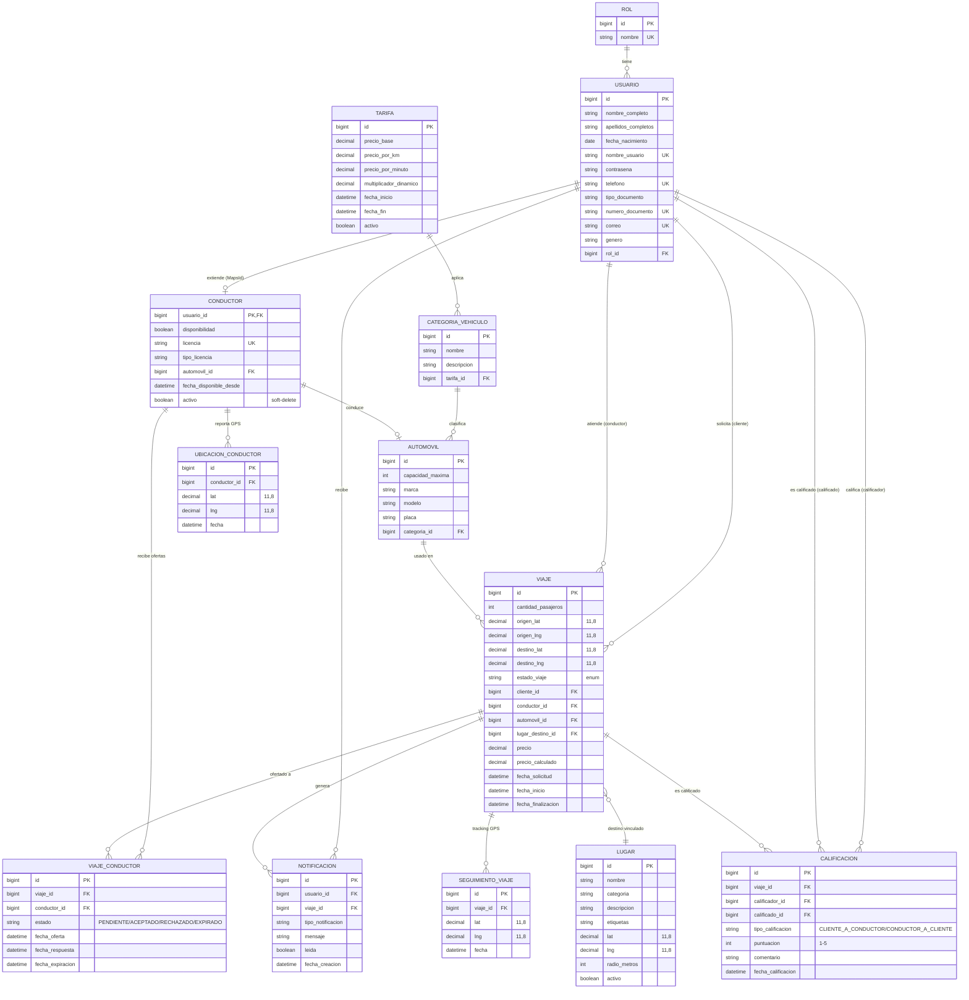

# GAV — Gestión y Asignación de Viajes
## Documento Técnico del Proyecto

> **Sistema institucional de asignación de viajes privados para huéspedes de hotel en Cartagena de Indias.** Integra autenticación por roles, algoritmo FIFO de asignación, optimización ILP, chatbot con LLM, tracking GPS y dashboard analítico Power BI.

---

## Tabla de Contenido

1. [Stack y Ambiente Tecnológico](#1-stack-y-ambiente-tecnológico)
2. [Arquitectura por Capas](#2-arquitectura-por-capas)
3. [Backend — Estructura del Proyecto Spring Boot](#3-backend--estructura-del-proyecto-spring-boot)
4. [Explicación de Capas del Backend](#4-explicación-de-capas-del-backend)
5. [Frontend — Estructura React](#5-frontend--estructura-react)
6. [Microservicio Optimizador (Python)](#6-microservicio-optimizador-python)
7. [Integración con el LLM (Gemini)](#7-integración-con-el-llm-gemini)
8. [Vistas del Sistema](#8-vistas-del-sistema)
9. [Modelo de Datos](#9-modelo-de-datos)
10. [Seguridad y Roles](#10-seguridad-y-roles)
11. [Configuración y Despliegue](#11-configuración-y-despliegue)
12. [Apéndice — Endpoints REST](#12-apéndice--endpoints-rest)

---

## 1. Stack y Ambiente Tecnológico

### Backend (API REST principal)
| Componente | Tecnología | Versión |
|---|---|---|
| Lenguaje | Java | 21 |
| Framework | Spring Boot | 4.0.5 |
| Build | Maven (wrapper `mvnw`) | 3.x |
| ORM / Persistencia | Spring Data JPA + Hibernate | 7 |
| Base de datos | MySQL | 8.0+ |
| Seguridad | Spring Security + JWT (`jjwt` 0.12.6) | — |
| HTTP Client | `RestTemplate` con `RestTemplateBuilder` (módulo `spring-boot-starter-restclient`) + `RestClient` | — |
| Mapeo de objetos | Lombok 1.18 + MapStruct 1.6.2 | — |
| WebSockets (preparado) | `spring-boot-starter-websocket` | — |
| Observabilidad | Actuator + datasource-micrometer | — |

### Frontend (SPA)
| Componente | Tecnología |
|---|---|
| Framework | React 18 + Vite |
| Estilos | Tailwind CSS (paleta dorado/marfil sobre fondo profundo) |
| Router | React Router DOM |
| HTTP | Axios con interceptor JWT |
| Mapa | Google Maps JavaScript API |

### Servicios externos
| Servicio | Uso |
|---|---|
| **Google Maps JS** | Renderizado del mapa, selección origen/destino, cálculo de ruta y distancia (Opción C: el frontend hace el cálculo, el backend NO consume Maps) |
| **Google Gemini API** (`gemini-2.5-flash`) | Chatbot de sugerencia de destinos en Cartagena |
| **Power BI Service** | Dashboard analítico embebido en la vista de admin |
| **MySQL local** | Persistencia |

### Microservicio Optimizador
| Componente | Tecnología |
|---|---|
| Lenguaje | Python 3.11 |
| Framework | FastAPI + Uvicorn |
| Optimización | PuLP (solver CBC integrado) — Programación Lineal Entera |
| Conector BD | mysql-connector-python (solo lectura) |
| ETL | Pandas |
| Empaquetado | Dockerfile |

### Ambiente de Desarrollo
- **IDE backend**: IntelliJ IDEA / VS Code con extensión Java
- **IDE frontend**: VS Code
- **Terminal**: Git Bash / PowerShell
- **DB cliente**: MySQL Workbench
- **API testing**: Postman
- **BI**: Power BI Desktop + On-premises Data Gateway

---

## 2. Arquitectura por Capas

GAV implementa **arquitectura en capas (n-tier)** con separación estricta de responsabilidades, complementada con dos servicios satélite (microservicio optimizador y LLM externo).

```
┌──────────────────────────────────────────────────────────────────────┐
│                     CLIENTE (Navegador Web)                          │
│   React SPA · Pages por rol · Tailwind · Google Maps JS              │
└────────────────────────────────┬─────────────────────────────────────┘
                                 │ HTTPS + JWT (header Authorization)
                                 ▼
┌──────────────────────────────────────────────────────────────────────┐
│                    BACKEND SPRING BOOT (puerto 8080)                 │
│                                                                      │
│  ┌──────────────┐   ┌──────────────┐   ┌──────────────────────────┐ │
│  │  Controller  │ → │   Service    │ → │       Repository         │ │
│  │  (REST API)  │   │ (Negocio)    │   │  (Spring Data JPA)       │ │
│  └──────────────┘   └──────┬───────┘   └────────────┬─────────────┘ │
│        ▲                   │                        │                │
│        │                   ▼                        ▼                │
│  ┌──────────────┐   ┌──────────────┐   ┌──────────────────────────┐ │
│  │     DTO      │   │   Security   │   │       Entity / Model     │ │
│  │  (Request/   │   │ JWT+Filters  │   │   (JPA @Entity)          │ │
│  │   Response)  │   │              │   │                          │ │
│  └──────────────┘   └──────────────┘   └──────────────────────────┘ │
│                                                                      │
│  ┌──────────────┐   ┌──────────────┐                                │
│  │  Exception   │   │    Config    │                                │
│  │  Handler     │   │ (Seeders)    │                                │
│  └──────────────┘   └──────────────┘                                │
└──────┬──────────────────────┬──────────────────────┬────────────────┘
       │                      │                      │
       ▼                      ▼                      ▼
   ┌────────┐         ┌────────────────┐    ┌──────────────────┐
   │ MySQL  │         │  Microservicio │    │  Gemini API      │
   │  gav1  │         │   Optimizer    │    │ (gemini-2.5-flash)│
   │        │         │ FastAPI+PuLP   │    │                  │
   └────────┘         │  (puerto 8001) │    └──────────────────┘
                      └────────┬───────┘
                               │ solo lectura
                               ▼
                            MySQL
```

### Principios aplicados
- **Separación de capas**: cada capa solo conoce la inmediatamente inferior (no salta capas).
- **Inyección de dependencias**: vía Spring (`@RequiredArgsConstructor` con Lombok).
- **Stateless API**: cada request porta su JWT; no hay sesión HTTP del lado del servidor.
- **Single responsibility**: cada Service maneja un dominio (Auth, Conductor, Cliente, Admin, Viaje, etc.).
- **DTO pattern**: Request/Response específicos evitan exponer entidades JPA al frontend.
- **CORS configurable** por properties para el frontend.

---

## 3. Backend — Estructura del Proyecto Spring Boot

```
src/main/java/com/GAV/gav/
│
├── GavApplication.java          ← @SpringBootApplication + @EnableScheduling
│
├── Controller/                  ← Capa de presentación REST
│   ├── AuthController.java          (registro/login público)
│   ├── AdminController.java         (gestión completa + estadísticas + BI)
│   ├── ClienteController.java       (solicitar viaje, perfil, calificar)
│   ├── ConductorController.java     (responder solicitud, máquina de estados)
│   ├── RecepcionistaController.java (check-in y solicitud por delegación)
│   ├── NotificacionController.java  (polling de notificaciones)
│   └── AsignacionController.java    (dispara el optimizador ILP)
│
├── Service/                     ← Lógica de negocio
│   ├── AuthService.java
│   ├── AdminService.java
│   ├── ClienteService.java
│   ├── ConductorService.java
│   ├── ViajeService.java         (FIFO + máquina de estados + scheduler)
│   ├── RecepcionistaService.java
│   ├── NotificacionService.java
│   ├── ChatbotService.java       (cliente Gemini)
│   ├── LugarService.java         (catálogo + estadísticas POIs)
│   ├── TrackingService.java      (GPS + Haversine)
│   └── OptimizadorService.java   (cliente del microservicio Python)
│
├── Repository/                  ← Capa de acceso a datos (Spring Data JPA)
│   ├── UsuarioRepository.java
│   ├── ConductorRepository.java     (incluye queries FIFO con exclusión)
│   ├── ViajeRepository.java         (queries de historial paginado + estadísticas)
│   ├── ViajeConductorRepository.java
│   ├── AutomovilRepository.java
│   ├── CategoriaVehiculoRepository.java
│   ├── TarifaRepository.java
│   ├── RolRepository.java
│   ├── LugarRepository.java
│   ├── CalificacionRepository.java
│   ├── NotificacionRepository.java
│   ├── UbicacionConductorRepository.java
│   └── SeguimientoViajeRepository.java
│
├── Model/                       ← Entidades JPA (@Entity)
│   ├── Usuario.java
│   ├── Conductor.java               (@MapsId 1:1 con Usuario, soft-delete)
│   ├── Automovil.java
│   ├── CategoriaVehiculo.java
│   ├── Tarifa.java
│   ├── Rol.java
│   ├── Viaje.java                   (enum EstadoViaje + FK a Lugar)
│   ├── ViajeConductor.java          (registro FIFO de ofertas)
│   ├── Lugar.java                   (catálogo POIs de Cartagena)
│   ├── Calificacion.java            (bidireccional con enum TipoCalificacion)
│   ├── Notificacion.java
│   ├── UbicacionConductor.java      (heartbeat GPS)
│   └── SeguimientoViaje.java        (puntos GPS durante el viaje)
│
├── DTO/
│   ├── Request/                 ← Payloads de entrada validados con jakarta.validation
│   │   ├── LoginRequest, RegisterClienteRequest, RegisterConductorRequest
│   │   ├── ActualizarConductorRequest, ActualizarPerfilClienteRequest
│   │   ├── CrearVehiculoRequest, ActualizarVehiculoRequest
│   │   ├── SolicitarViajeRequest, CalificarViajeRequest
│   │   ├── ChatbotRequest, RegistrarUbicacionRequest
│   │   └── ActualizarPerfilConductorRequest, ActualizarPerfilAdminRequest
│   │
│   └── Response/                ← Payloads de salida (DTOs aplanados, sin recursividad)
│       ├── UsuarioResponse, LoginResponse, ConductorResponse, VehiculoResponse
│       ├── ViajeResponse, ViajeDetalleClienteResponse, ViajeDetalleConductorResponse
│       ├── PerfilClienteResponse, PerfilConductorResponse
│       ├── CalificacionResponse, PromedioCalificacionResponse
│       ├── NotificacionResponse, GananciasResponse, ViajesPorDiaResponse
│       ├── LugarPopularResponse, ChatbotResponse, ConductorCercanoResponse
│       ├── UbicacionResponse, PuntoSeguimientoResponse, SolicitudResponse
│       ├── AsignacionResultDTO
│       └── PageResponse<T>      (wrapper de paginación)
│
├── Security/
│   ├── SecurityConfig.java          (filtros + CORS + matchers por rol)
│   ├── JwtService.java              (firma/verificación HMAC-SHA256)
│   ├── JwtAuthFilter.java           (extrae token de cada request)
│   ├── UserDetailsServiceImpl.java  (carga usuario; bloquea conductor inactivo)
│   ├── AuthenticatedUserProvider.java (helper para obtener usuario actual)
│   ├── RestAuthenticationEntryPoint.java (401 estructurado)
│   └── RestAccessDeniedHandler.java     (403 estructurado)
│
├── Exception/
│   ├── BusinessException.java        (excepción de dominio con HttpStatus)
│   └── GlobalExceptionHandler.java   (@RestControllerAdvice)
│
└── Config/                      ← Seeders idempotentes
    ├── RolSeeder.java
    ├── TarifaSeeder.java
    ├── CategoriaVehiculoSeeder.java
    ├── AdminSeeder.java
    └── LugarSeeder.java         (22 POIs reales de Cartagena)
```

```
src/main/resources/
├── application.properties        ← Perfil default + perfil activo = dev
├── application-dev.properties    ← Overrides desarrollo (URL BD, logs, etc.)
└── secrets.properties            ← API keys (gitignored)
```

---

## 4. Explicación de Capas del Backend

### 4.1 Capa Controller (`@RestController`)
**Responsabilidad**: exponer endpoints HTTP REST, parsear/validar requests, delegar a Service, serializar response.

**Patrón aplicado**:
```java
@RestController
@RequestMapping("/api/<rol>")
@RequiredArgsConstructor
public class XxxController {
    private final XxxService service;
    private final AuthenticatedUserProvider auth;

    @PostMapping("/recurso")
    public ResponseEntity<Response> action(@Valid @RequestBody Request req) {
        Long userId = auth.getCurrentUserId();
        return ResponseEntity.ok(service.doSomething(userId, req));
    }
}
```

**No contiene lógica de negocio** — solo orquesta. Validaciones declarativas con `@Valid` + anotaciones `jakarta.validation` en DTOs (`@NotBlank`, `@Min`, `@Email`...).

### 4.2 Capa Service (`@Service`)
**Responsabilidad**: implementar reglas de negocio, coordinar repositories, manejar transacciones.

**Características clave**:
- Anotación `@Transactional` en métodos que modifican estado.
- Lanzan `BusinessException(mensaje, HttpStatus)` para errores controlados.
- Reciben/retornan **DTOs**, no entidades.
- Inyectan dependencias por constructor (Lombok `@RequiredArgsConstructor`).

**Ejemplo — `ViajeService.solicitarViaje`**:
1. Busca cliente (`UsuarioRepository.findById`).
2. Calcula precio con `Tarifa` activa.
3. Empareja destino con `Lugar` del catálogo (Haversine).
4. Persiste `Viaje` en estado `SOLICITADO`.
5. Dispara `asignarPrimerConductorFIFO(viaje)` que ordena conductores por `fechaDisponibleDesde` ASC y notifica al primero.

### 4.3 Capa Repository (`extends JpaRepository`)
**Responsabilidad**: acceso a datos sin lógica.

**Tipos de queries**:
- **Derivadas**: `findByEstadoViaje(EstadoViaje estado)` → JPA infiere SQL.
- **JPQL explícitas** con `@Query`: cuando el filtro es complejo. Ejemplo:
  ```java
  @Query("""
      SELECT c FROM Conductor c
      WHERE c.disponibilidad = true
      AND (c.activo IS NULL OR c.activo = true)
      AND c.automovil.capacidadMaxima >= :pasajeros
      AND c NOT IN (...exclusión por viaje específico...)
      ORDER BY c.fechaDisponibleDesde ASC
  """)List<Conductor> findSiguienteConductorFIFO(...);
  ```
- **Native SQL**: solo cuando JPQL es insuficiente (ej. `DATE(fecha)` para agrupaciones por día).

### 4.4 Capa Model / Entity (`@Entity`)
**Responsabilidad**: representar tablas de la BD como objetos Java con metadatos JPA.

**Patrones aplicados**:
- `@Table(name = "...")` explícito.
- `@Id` + `@GeneratedValue(strategy = IDENTITY)` para PKs auto-incremento.
- `@Column(name=..., precision=11, scale=8)` para lat/lng (clave para precisión decimal).
- `@ManyToOne @JoinColumn(name=...)` para FKs.
- `@OneToOne @MapsId` para herencia compartida (Conductor extiende Usuario).
- `@Enumerated(EnumType.STRING)` para enums (legibles en BD).

**Decisiones de diseño relevantes**:
- `Conductor.activo`: soft-delete que excluye al conductor del FIFO y del login, conservando historial.
- `Viaje.lugarDestino`: FK opcional al catálogo; permite ranking de POIs sin estructuras extra.
- `ViajeConductor`: registro normalizado de cada oferta FIFO (PENDIENTE → ACEPTADO/RECHAZADO/EXPIRADO).

### 4.5 Capa DTO
**Responsabilidad**: desacoplar el modelo interno del contrato externo.

- **Request DTOs**: input con validación. Inmutables del lado del cliente.
- **Response DTOs**: serialización JSON sin riesgo de referencias circulares (relaciones bidireccionales en JPA causan stack overflow al serializar). Cada Response es **aplanado** (`marca`, `modelo`, `placa` directos en `ConductorResponse`, no un objeto anidado `Automovil`).
- **`PageResponse<T>`**: wrapper que envuelve `Page<T>` de Spring Data con solo los campos que el frontend necesita (`content`, `page`, `size`, `totalElements`, `totalPages`, `isLast`).

### 4.6 Capa Security
- **`SecurityConfig`**: filtro chain con sesión STATELESS, CORS configurable, matchers por rol:
  - `/api/auth/**` → `permitAll`
  - `/api/admin/**` → `hasRole("ADMIN")`
  - `/api/cliente/**` → `hasRole("CLIENTE")`
  - `/api/conductor/**` → `hasRole("CONDUCTOR")`
  - `/api/recepcionista/**` → `hasRole("RECEPCIONISTA")`
- **`JwtAuthFilter`**: intercepta cada request, extrae `Authorization: Bearer <token>`, valida firma y expiración, popula `SecurityContext`.
- **`UserDetailsServiceImpl`**: carga usuario desde BD; si es Conductor inactivo, devuelve `UserDetails` con `enabled=false` → bloquea login.
- **`AuthenticatedUserProvider`**: helper que retorna el `Usuario` actual a partir del `SecurityContext`.

### 4.7 Capa Exception
- **`BusinessException`**: excepción tipo "checked" llevando el `HttpStatus` que el front debe ver.
- **`GlobalExceptionHandler`** (`@RestControllerAdvice`):
  - `BusinessException` → status definido por el dominio.
  - `MethodArgumentNotValidException` → 400 con detalle por campo.
  - `BadCredentialsException` / `DisabledException` → 401 con mensaje claro.
  - `AccessDeniedException` → 403.
  - `DataIntegrityViolationException` → 409 (FKs activas al borrar).
  - `Exception` (catch-all) → 500 estructurado.

### 4.8 Capa Config (Seeders)
**`CommandLineRunner`** idempotentes que pueblan datos base la primera vez:
- `RolSeeder`: ROLE_ADMIN, ROLE_CLIENTE, ROLE_CONDUCTOR, ROLE_RECEPCIONISTA.
- `TarifaSeeder`: tarifa por defecto si no hay activa.
- `CategoriaVehiculoSeeder`: SEDAN, VAN, EJECUTIVO, ECONOMICO.
- `AdminSeeder`: usuario admin con hash BCrypt si no existe.
- `LugarSeeder`: 22 POIs reales de Cartagena (Castillo San Felipe, Ciudad Amurallada, Bocagrande, etc.).

Todos verifican existencia (`if (repo.count() == 0)` o `if (repo.findByNombre(...).isEmpty())`) antes de insertar → **nunca duplican ni sobrescriben**.

---

## 5. Frontend — Estructura React

```
frontend/src/
│
├── App.jsx                       ← Provider chain (Auth, Toast) + Router
├── main.jsx                      ← Entry point Vite
├── index.css                     ← Tailwind directives + variables CSS
│
├── api/                          ← Clientes HTTP (axios)
│   ├── axios.js                      (instancia base + interceptor JWT)
│   ├── auth.api.js
│   ├── admin.api.js
│   ├── cliente.api.js
│   ├── conductor.api.js
│   └── notificaciones.api.js
│
├── pages/                        ← Vistas por rol
│   ├── auth/LoginPage.jsx
│   ├── NotFoundPage.jsx
│   │
│   ├── admin/
│   │   ├── DashboardPage.jsx     (resumen + Power BI iframe)
│   │   ├── ConductoresPage.jsx   (CRUD + edición completa + vehículo)
│   │   ├── VehiculosPage.jsx
│   │   ├── ClientesPage.jsx
│   │   ├── ViajesPage.jsx        (historial paginado)
│   │   ├── EstadisticasPage.jsx  (ganancias, conteos)
│   │   └── AsignacionPage.jsx    (dispara optimizador ILP)
│   │
│   ├── cliente/
│   │   ├── DashboardPage.jsx     (mapa + solicitar viaje)
│   │   ├── SeguimientoPage.jsx   (estado en vivo del viaje)
│   │   ├── HistorialPage.jsx
│   │   └── ChatbotPage.jsx       (asistente Gemini)
│   │
│   ├── conductor/
│   │   ├── DashboardPage.jsx     (solicitudes + máquina de estados)
│   │   ├── HistorialPage.jsx
│   │   ├── GananciasPage.jsx
│   │   └── CalificacionesPage.jsx
│   │
│   └── shared/
│       ├── PerfilPage.jsx        (datos personales editables)
│       └── NotificacionesPage.jsx
│
├── components/                   ← UI reutilizable
│   ├── ui/                       (Button, Card, Modal, Input, Badge, Spinner,
│   │                              Table, PageHeader, StatCard, BarChart, Stars)
│   ├── icons/Icons.jsx           (iconos SVG inline)
│   ├── layout/Sidebar.jsx        (nav lateral con badge por rol)
│   ├── map/
│   │   ├── MapView.jsx           (wrapper Google Maps)
│   │   └── geocode.js            (reverse geocoding por coordenada)
│   ├── auth/AbstractComposition.jsx
│   └── shared/
│       ├── ProtectedRoute.jsx    (gate por autenticación)
│       └── RoleGuard.jsx         (gate por rol)
│
├── context/                      ← Estado global
│   ├── AuthContext.jsx           (token + usuario + login/logout)
│   └── ToastContext.jsx          (sistema de notificaciones)
│
├── hooks/
│   ├── useAuth.js                (consumidor de AuthContext)
│   ├── useGoogleMaps.js          (carga del script de Maps)
│   └── useRoleGate.js            (verifica rol antes de hacer requests)
│
├── routes/AppRouter.jsx          ← Definición de rutas con guards
├── layouts/DashboardLayout.jsx   (sidebar + outlet)
├── constants/roles.js
└── utils/jwt.js                  (decodificación local del JWT)
```

### Patrones aplicados en el frontend

1. **API client unificado**: una sola instancia de Axios con `baseURL = http://localhost:8080/api` y un interceptor que inyecta `Authorization: Bearer <token>` automáticamente.
2. **Polling REST** (no WebSockets) para tiempo real:
   - Cliente: `viajeActivo` y `seguimientoUltima` cada 6s en `SeguimientoPage`.
   - Conductor: `solicitudPendiente` y `viajeActivo` cada 6s en su `DashboardPage`.
   - Admin: stats cada 30s.
3. **Detección de cancelaciones**: si `viajeActivo` deja de devolver el viaje, se consulta `detalleViaje(prev.id)` para saber si pasó a CANCELADO y mostrar feedback.
4. **Defensa de roles en cliente**: `useRoleGate(ROLES.X)` bloquea requests si el rol del JWT no coincide → evita 403 innecesarios.
5. **Toast unificado**: éxito/error/info estructurados por `ToastContext`.
6. **Manejo de fechas timezone-safe**: parsing local `YYYY-MM-DD` vía split, no `new Date(string)` que parsea como UTC y desfasa el día.

---

## 6. Microservicio Optimizador (Python)

Servicio independiente que **lee la BD MySQL en modo solo lectura** y resuelve un modelo de Programación Lineal Entera (ILP) para asignar conductores a viajes pendientes maximizando cobertura.

```
optimizer/
├── main.py                       ← FastAPI app + /health + uvicorn :8001
├── requirements.txt
├── Dockerfile
└── app/
    ├── api/
    │   ├── routes.py             (POST /api/v1/assign)
    │   └── schemas.py            (Pydantic: AssignRequest, AssignResponse, Asignacion)
    ├── services/
    │   └── assign_service.py     (conexión MySQL + pandas + orquestación)
    └── optimizer/
        ├── model.py              (construcción del problema PuLP)
        └── solver.py             (ejecución CBC + extracción de resultados)
```

### Modelo matemático (ILP)
- **Variables**: `x[c,v] ∈ {0,1}` por cada par (conductor `c`, viaje `v`).
- **Objetivo**: `max Σ x[c,v]` (maximizar viajes cubiertos).
- **Restricciones**:
  - `Σ_c x[c,v] ≤ 1` ∀ viaje (cada viaje recibe a lo sumo un conductor).
  - `Σ_v x[c,v] ≤ 1` ∀ conductor (cada conductor cubre a lo sumo un viaje).
- **Solver**: CBC (incluido en PuLP).

### Integración Spring → Optimizer
- `OptimizadorService` (Spring) usa `RestTemplateBuilder` con timeouts.
- Llama `POST http://localhost:8001/api/v1/assign`.
- Maneja: respuesta vacía, microservicio caído (503), error genérico (502).
- Endpoint expuesto: `POST /api/asignacion/ejecutar`.

### Credenciales
Por variables de entorno (`DB_HOST`, `DB_PORT`, `DB_USER`, `DB_PASSWORD`, `DB_NAME`), nunca hardcodeadas.

---

## 7. Integración con el LLM (Gemini)

GAV integra **Google Gemini** (`gemini-2.5-flash`) como asistente de sugerencia de destinos para clientes.

### Arquitectura

```
┌──────────────────────┐                ┌─────────────────────────┐
│  Frontend Cliente    │                │  ChatbotService.java    │
│  ChatbotPage.jsx     │  POST mensaje  │                         │
│                      │───────────────▶│  1. Carga lugares       │
│  "Restaurante de     │                │     más solicitados     │
│   mariscos en        │                │     (BD + LugarService) │
│   Cartagena"         │                │  2. Carga catálogo POIs │
│                      │                │  3. Construye system    │
│                      │                │     prompt con grounding│
│                      │                │  4. Llama Gemini        │
│                      │                │     (RestClient HTTP)   │
│                      │  ← respuesta   │  5. Parsea respuesta    │
└──────────────────────┘                └─────────┬───────────────┘
                                                  │
                                                  ▼
                                  ┌───────────────────────────────────┐
                                  │  Google Gemini API                │
                                  │  generativelanguage.googleapis... │
                                  │  Modelo: gemini-2.5-flash         │
                                  └───────────────────────────────────┘
```

### Características del prompt
**Restricción dura** en el system prompt:
> *"Eres un asistente que SOLO sugiere lugares y destinos en Cartagena de Indias y sus corregimientos aledaños. NO respondas sobre uso de la app, tarifas ni soporte; redirige a sugerir un destino. Si preguntan por otra ciudad, aclara cortésmente que solo cubres Cartagena."*

**Grounding inyectado**:
- Top N lugares más solicitados según históricos de la app.
- Catálogo completo de POIs conocidos (nombre, categoría, etiquetas).

### Decisiones técnicas
- **Sin estado**: cada mensaje es independiente, no se persiste historial (decisión de simplicidad).
- **API key**: vive en `secrets.properties` (gitignored), inyectada vía `${CHATBOT_API_KEY}`.
- **Timeout**: 15s configurable.
- **Cliente HTTP**: `RestClient` con `SimpleClientHttpRequestFactory` para timeouts.
- **Manejo de errores**: si Gemini no responde, retorna `503 Service Unavailable` con mensaje claro al frontend; el resto de la app sigue funcional.

### Endpoint
```
POST /api/cliente/chatbot/mensaje
Body: { "mensaje": "..." }
Response: { "respuesta": "...", "lugaresMasSolicitados": [...] }
```

---

## 8. Vistas del Sistema

### 8.1 Vistas Públicas
| Vista | Ruta | Componente |
|---|---|---|
| Login | `/login` | `LoginPage.jsx` |

### 8.2 Vistas del Administrador (`ROLE_ADMIN`)
| Vista | Ruta | Funcionalidad |
|---|---|---|
| Dashboard | `/admin` | KPIs en tarjetas + iframe Power BI |
| Conductores | `/admin/conductores` | Listado con filtros · Crear · **Editar completo** · Asignar/cambiar/quitar vehículo · Soft-delete |
| Vehículos | `/admin/vehiculos` | CRUD vehículos |
| Clientes | `/admin/clientes` | Listado de clientes |
| Viajes | `/admin/viajes` | Historial paginado con filtros |
| Estadísticas | `/admin/estadisticas` | Ganancias diarias/mensuales, conteos |
| Asignación ILP | `/admin/asignacion` | Botón para correr el optimizador y ver resultado |

### 8.3 Vistas del Cliente (`ROLE_CLIENTE`)
| Vista | Ruta | Funcionalidad |
|---|---|---|
| Solicitar viaje | `/cliente` | Mapa Google · selección origen/destino · cálculo precio · redirección automática a seguimiento |
| Seguimiento | `/cliente/seguimiento` | Estado del viaje en vivo (timeline) · posición conductor · datos vehículo · soporta CANCELADO/FINALIZADO con fallback |
| Historial | `/cliente/historial` | Lista de viajes con filtros |
| Chatbot | `/cliente/chatbot` | Asistente de sugerencias Gemini |

### 8.4 Vistas del Conductor (`ROLE_CONDUCTOR`)
| Vista | Ruta | Funcionalidad |
|---|---|---|
| Dashboard | `/conductor` | Solicitud entrante (oferta) · viaje activo · máquina de estados · banner de cancelación por cliente |
| Historial | `/conductor/historial` | Listado de viajes pasados |
| Ganancias | `/conductor/ganancias` | Tarjetas diarias/mensuales · resumen con fecha real (timezone-safe) |
| Calificaciones | `/conductor/calificaciones` | Promedio + listado de calificaciones recibidas |

### 8.5 Vistas Compartidas
| Vista | Funcionalidad |
|---|---|
| Perfil | Edición de datos modificables (género, teléfono, email, contraseña) |
| Notificaciones | Listado con polling, marcado como leídas |

### 8.6 Diseño visual
- **Paleta**: dorado/marfil (`gold`, `ink`, `subtle`) sobre fondo profundo (`bg-base`, `surface`).
- **Tipografía**: serif para títulos (elegancia hotelera), sans-serif para contenido.
- **Componentes consistentes**: Card, Badge con tones (green, blue, amber, red), Modal con max-width responsive.
- **Mobile-first**: grid `grid-cols-1 sm:grid-cols-2 lg:grid-cols-3` en la mayoría de páginas.

---

## 9. Modelo de Datos

### Diagrama Entidad-Relación



### Descripción de Tablas

| Tabla | Propósito |
|---|---|
| **rol** | Catálogo de roles: ROLE_ADMIN, ROLE_CLIENTE, ROLE_CONDUCTOR, ROLE_RECEPCIONISTA |
| **usuario** | Datos personales y credenciales. Base de toda autenticación. |
| **conductor** | Especialización de usuario con licencia, disponibilidad, vehículo asignado y soft-delete (`activo`) |
| **automovil** | Vehículos del sistema con categoría y capacidad |
| **categoria_vehiculo** | SEDAN, VAN, EJECUTIVO, ECONOMICO + tarifa asociada |
| **tarifa** | Precio base, por km, por minuto, multiplicador dinámico |
| **lugar** | Catálogo de 22 POIs reales de Cartagena con coords, etiquetas y radio de match |
| **viaje** | Núcleo transaccional. Coords origen/destino, estado, FKs cliente/conductor/vehículo/lugar, precio, timestamps |
| **viaje_conductor** | Registro FIFO de cada oferta a un conductor con su resolución (aceptado/rechazado/expirado) |
| **notificacion** | Buzón por usuario para eventos del sistema (asignación, cancelación, nuevas calificaciones, etc.) |
| **calificacion** | Bidireccional cliente↔conductor, puntuación 1-5 + comentario |
| **ubicacion_conductor** | Heartbeat GPS de conductores disponibles (para "conductores cercanos") |
| **seguimiento_viaje** | Puntos GPS durante un viaje activo (recorrido en vivo) |

### Decisiones de modelado importantes

1. **`Conductor` como herencia 1:1 de `Usuario`** mediante `@MapsId` → la PK del conductor ES la PK del usuario. Simplifica login (un solo flujo) y mantiene integridad.
2. **`lugar_destino_id` en `viaje`** (nullable): se llena automáticamente cuando las coordenadas del destino caen dentro del radio de un POI conocido (Haversine en `ViajeService`). Habilita queries de "lugares más solicitados" sin agrupar por coords flotantes.
3. **Precisión `DECIMAL(11,8)`** en todas las coordenadas (lat/lng): garantiza ~1 mm de precisión. Sin esto, Hibernate usa por default `scale=2` y todos los puntos de Cartagena colapsan al mismo lugar en el mapa.
4. **`Calificacion.tipo_calificacion`** como enum string permite **ambas direcciones** (CLIENTE_A_CONDUCTOR y CONDUCTOR_A_CLIENTE) con el mismo esquema sin tablas separadas.
5. **`Conductor.activo` (soft-delete)** + bloqueo de login en `UserDetailsServiceImpl`: cuando se "deshabilita" un conductor, mantenemos todo su histórico (viajes, calificaciones) pero no puede operar ni autenticarse.

---

## 10. Seguridad y Roles

### Esquema de autenticación
1. Usuario hace `POST /api/auth/login` con `nombreUsuario` + `contrasena`.
2. `AuthService` valida con `AuthenticationManager` (BCrypt).
3. Si OK, `JwtService` genera token HS256 con claim `rol`.
4. Cliente guarda token y lo envía en `Authorization: Bearer <token>` en cada request.
5. `JwtAuthFilter` (por request) extrae, valida y popula `SecurityContext`.
6. Spring Security autoriza según matcher por rol.

### Matchers (`SecurityConfig`)
```
/api/auth/**              → permitAll
/api/admin/**             → hasRole("ADMIN")
/api/recepcionista/**     → hasRole("RECEPCIONISTA")
/api/cliente/**           → hasRole("CLIENTE")
/api/conductor/**         → hasRole("CONDUCTOR")
/api/notificaciones/**    → authenticated (cualquier rol)
/api/asignacion/**        → authenticated (admin típicamente)
```

### Endpoints públicos adicionales
- `/swagger-ui/**`, `/v3/api-docs/**` (documentación API)

### CORS
Configurado en `SecurityConfig.corsConfigurationSource()`:
- Orígenes: `http://localhost:5173` (Vite default), `http://localhost:3000` (CRA).
- Configurable vía property `cors.allowed-origins`.
- Métodos: GET, POST, PUT, PATCH, DELETE, OPTIONS.
- Headers expuestos: `Authorization`.

### Manejo de identidad
`AuthenticatedUserProvider` provee `getCurrentUser()` y `getCurrentUserId()` desde el `SecurityContext`. Todos los controllers lo usan para identificar al usuario actual sin necesidad de IDs en URLs sensibles.

---

## 11. Configuración y Despliegue

### Archivos de configuración

| Archivo | Rol |
|---|---|
| `application.properties` | Configuración base + activación forzada del perfil `dev` |
| `application-dev.properties` | Overrides de desarrollo (URL BD, logs, etc.) |
| `secrets.properties` | API keys (gitignored) — solo `CHATBOT_API_KEY` |

### Persistencia
- `spring.jpa.hibernate.ddl-auto=update` → Hibernate añade columnas/tablas faltantes pero **nunca borra** datos entre arranques.
- `spring.profiles.active=dev` forzado para garantizar consistencia entre IDE y línea de comandos.
- BD canónica: `gav1` en `127.0.0.1:3306`.

### Arranque

```bash
# Backend (puerto 8080)
./mvnw spring-boot:run

# Frontend (puerto 5173)
cd frontend
npm install
npm run dev

# Microservicio Optimizer (puerto 8001)
cd optimizer
pip install -r requirements.txt
export DB_HOST=127.0.0.1 DB_USER=root DB_PASSWORD=12345 DB_NAME=gav1
python main.py
```

### Variables de entorno relevantes
- `CHATBOT_API_KEY` → Gemini API key
- `DB_HOST`, `DB_PORT`, `DB_USER`, `DB_PASSWORD`, `DB_NAME` → para optimizer

### Power BI
- Dataset publicado en Power BI Service.
- Conectado a MySQL local vía **On-premises Data Gateway**.
- Modo recomendado: **DirectQuery** para tiempo real.
- Reporte embebido vía iframe en `AdminDashboardPage.jsx`.

---

## 12. Apéndice — Endpoints REST

### Auth (público)
```
POST   /api/auth/register/cliente
POST   /api/auth/login
```

### Admin (`ROLE_ADMIN`)
```
# Conductores
POST   /api/admin/conductores
GET    /api/admin/conductores?disponibilidad=&tipoLicencia=&incluirInactivos=
GET    /api/admin/conductores/{id}
PUT    /api/admin/conductores/{id}
POST   /api/admin/conductores/{id}/deshabilitar
POST   /api/admin/conductores/{id}/habilitar
DELETE /api/admin/conductores/{id}

# Vehículos
POST   /api/admin/vehiculos
GET    /api/admin/vehiculos
GET    /api/admin/vehiculos/{id}
PUT    /api/admin/vehiculos/{id}
DELETE /api/admin/vehiculos/{id}

# Asociación conductor ↔ vehículo
POST   /api/admin/conductores/{cId}/vehiculo/{vId}
DELETE /api/admin/conductores/{cId}/vehiculo

# Historial y estadísticas
GET    /api/admin/viajes?estado=&clienteId=&conductorId=&desde=&hasta=&page=&size=
GET    /api/admin/estadisticas/ganancias/dia?fecha=
GET    /api/admin/estadisticas/ganancias/mes?anio=&mes=
GET    /api/admin/estadisticas/viajes/dia?fecha=
GET    /api/admin/estadisticas/viajes/por-dia?desde=&hasta=
GET    /api/admin/viajes/{id}/seguimiento
```

### Cliente (`ROLE_CLIENTE`)
```
# Viajes
POST   /api/cliente/viajes
GET    /api/cliente/viajes/mis
GET    /api/cliente/viajes/{id}
GET    /api/cliente/viajes?estado=&desde=&hasta=&page=&size=
POST   /api/cliente/viajes/{id}/cancelar

# Perfil y mapa
GET    /api/cliente/perfil
PUT    /api/cliente/perfil
GET    /api/cliente/viaje-activo
GET    /api/cliente/viajes/{id}/detalle
GET    /api/cliente/conductores-cercanos?lat=&lng=&radioKm=
GET    /api/cliente/viajes/{id}/seguimiento/ultima
GET    /api/cliente/viajes/{id}/seguimiento

# Calificaciones y chatbot
POST   /api/cliente/viajes/{id}/calificar
GET    /api/cliente/calificaciones
GET    /api/cliente/calificaciones/promedio
POST   /api/cliente/chatbot/mensaje
GET    /api/cliente/lugares/mas-solicitados
```

### Conductor (`ROLE_CONDUCTOR`)
```
# Solicitudes y máquina de estados
GET    /api/conductor/solicitudes/pendiente
POST   /api/conductor/viajes/{id}/responder?aceptar=
POST   /api/conductor/viajes/{id}/en-camino
POST   /api/conductor/viajes/{id}/iniciar
POST   /api/conductor/viajes/{id}/finalizar
POST   /api/conductor/viajes/{id}/cancelar

# Perfil y mapa
GET    /api/conductor/perfil
PUT    /api/conductor/perfil
GET    /api/conductor/viaje-activo
GET    /api/conductor/viajes/{id}/detalle

# Historial
GET    /api/conductor/viajes?estado=&page=&size=
GET    /api/conductor/viajes/en-proceso
GET    /api/conductor/solicitudes?estado=&page=&size=

# Estadísticas
GET    /api/conductor/estadisticas/ganancias/dia?fecha=
GET    /api/conductor/estadisticas/ganancias/mes?anio=&mes=
GET    /api/conductor/estadisticas/viajes/dia?fecha=
GET    /api/conductor/estadisticas/viajes/mes?anio=&mes=

# Calificaciones y tracking
POST   /api/conductor/viajes/{id}/calificar-cliente
GET    /api/conductor/calificaciones
GET    /api/conductor/calificaciones/promedio
POST   /api/conductor/ubicacion
POST   /api/conductor/viajes/{id}/seguimiento
GET    /api/conductor/viajes/{id}/seguimiento
```

### Recepcionista (`ROLE_RECEPCIONISTA`)
```
POST   /api/recepcionista/clientes
POST   /api/recepcionista/clientes/{clienteId}/viajes
GET    /api/recepcionista/viajes
GET    /api/recepcionista/viajes/{id}
GET    /api/recepcionista/conductores
```

### Notificaciones (cualquier autenticado)
```
GET    /api/notificaciones/mias
GET    /api/notificaciones/no-leidas
GET    /api/notificaciones/no-leidas/count
PUT    /api/notificaciones/{id}/leer
```

### Asignación ILP
```
POST   /api/asignacion/ejecutar       (Spring → Optimizer Python)
```

### Microservicio Optimizer (`http://localhost:8001`)
```
GET    /health
POST   /api/v1/assign        Body opcional: { "estado_viaje": "BUSCANDO_CONDUCTOR", "solo_sin_conductor": true }
```

---

## Glosario

- **FIFO**: First In, First Out. Algoritmo de asignación que prioriza al conductor disponible que lleva más tiempo esperando (orden por `fechaDisponibleDesde` ASC).
- **POI**: Point of Interest. Lugar conocido del catálogo (Castillo, playa, mall, etc.).
- **ILP**: Integer Linear Programming. Optimización con variables enteras y restricciones lineales.
- **Haversine**: Fórmula para calcular distancia entre dos puntos en una esfera (la Tierra).
- **Soft-delete**: Marcar un registro como inactivo sin eliminarlo de la BD.
- **JWT**: JSON Web Token. Estándar para tokens de autenticación firmados.
- **DTO**: Data Transfer Object. Objeto plano para mover datos entre capas/sistemas.
- **DirectQuery**: Modo de Power BI donde el reporte consulta la BD en vivo (vs Import, que copia los datos).
- **Polling REST**: Patrón de "tiempo real" donde el cliente consulta repetidamente al servidor (vs WebSocket push).

---

*Documento generado para el proyecto GAV — Gestión y Asignación de Viajes.*
